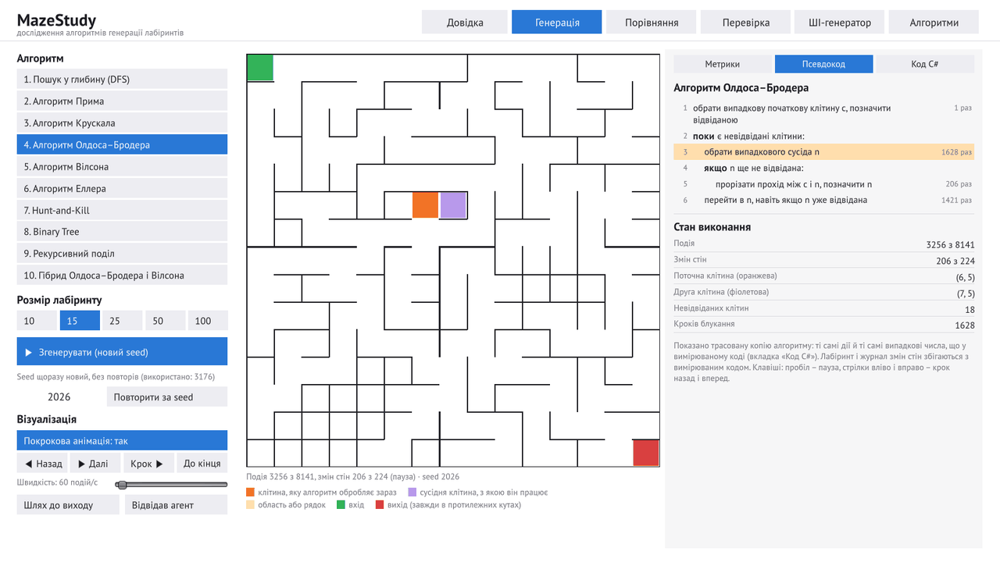
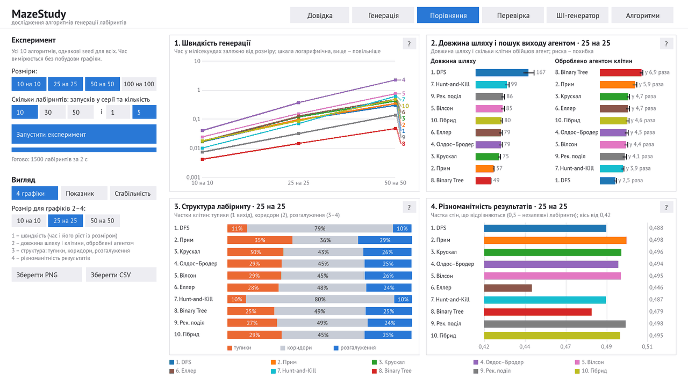
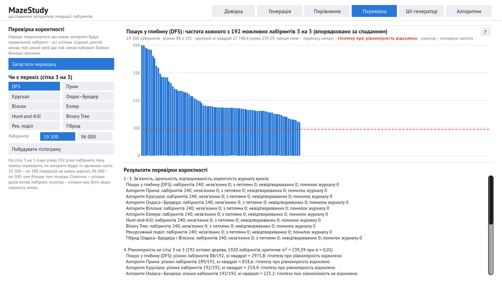
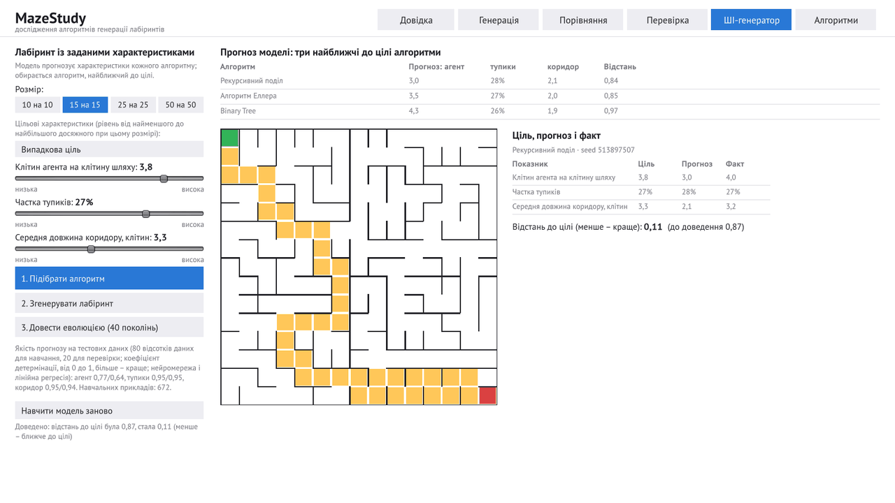
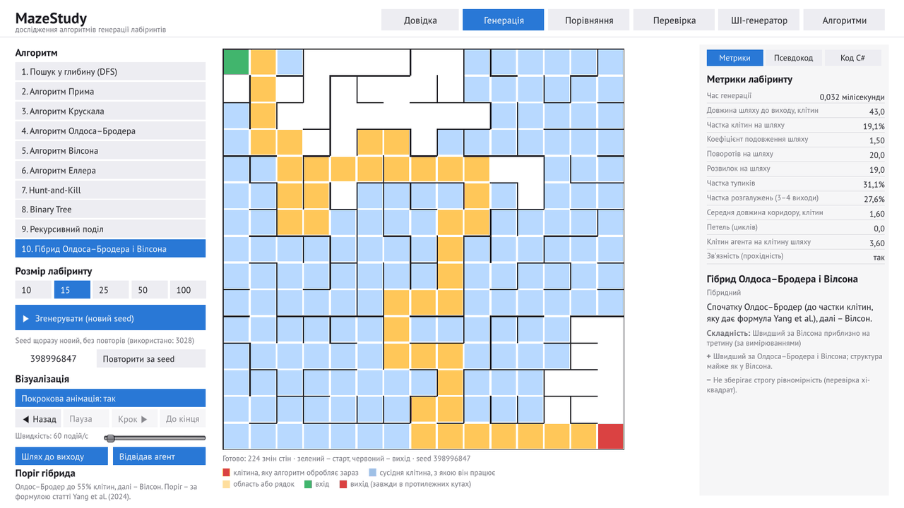

# MazeStudy – вибір алгоритму генерації лабіринту для гри

Програма до кваліфікаційної роботи магістра «Дослідження алгоритмів процедурної генерації лабіринтів для застосування в розробці ігор» (спеціальність F3 «Комп'ютерні науки»).

## Навіщо ця програма

У іграх лабіринти часто створює програма, а не художник. Алгоритмів для цього багато, і кожен будує свій тип лабіринту: один – довгий заплутаний шлях, інший – багато тупиків, третій – дуже швидко, але передбачувано. MazeStudy допомагає розробнику гри обрати алгоритм під потрібний рівень:

- показує, як кожен алгоритм крок за кроком будує лабіринт;
- вимірює, який лабіринт виходить: довжину шляху, частку тупиків, коридори, час побудови;
- порівнює десять алгоритмів в однакових умовах;
- сам підбирає алгоритм, якщо задати, який лабіринт потрібен.



Докладно про кожну вкладку, кольори і показники: [docs/Посібник.md](docs/Посібник.md).

## Запуск

| Система | Що запускати |
|---|---|
| Windows | архів `MazeStudy_Windows.zip`: розпакувати й запустити `MazeStudy_Windows/MazeStudy.exe` |
| Linux (x86_64) | архів `MazeStudy_Linux.tar.gz`: `tar -xzf MazeStudy_Linux.tar.gz`, потім `./MazeStudy_Linux/MazeStudy.x86_64` |

Готові збірки не зберігаються в репозиторії: вони великі й відтворюються з коду, тому їх прикладено до релізу. Щоб зібрати програму самостійно, відкрийте проєкт у Unity 6000.0.38f1 і оберіть у меню **MazeStudy → Зібрати програму** (Windows) або **Зібрати програму (Linux)**.

Збирання з командного рядка:

```
Unity -batchmode -quit -projectPath <шлях до проєкту> -executeMethod MazeStudy.StudyBuild.Build
Unity -batchmode -quit -projectPath <шлях до проєкту> -executeMethod MazeStudy.StudyBuild.BuildLinux
```

## Вкладки програми

| Вкладка | Для чого |
|---|---|
| Генерація | Обрати алгоритм і розмір, побачити, як будується лабіринт: підсвічено рядок алгоритму, що виконується, і клітину, з якою він працює. Праворуч – показники цього лабіринту |
| Порівняння | Усі десять алгоритмів генерують лабіринти в однакових умовах; чотири графіки: швидкість, довжина шляху, будова лабіринту, різноманітність |
| Перевірка | Переконатися, що кожен алгоритм будує правильний лабіринт, і перевірити, чи немає в алгоритму перекосу (на сітці 3 на 3, де існує рівно 192 різні лабіринти) |
| ШІ-генератор | Задати, який лабіринт потрібен (скільки тупиків, які коридори, наскільки заплутаний), – програма обере алгоритм і доведе лабіринт до цілі |
| Алгоритми | Короткий опис кожного алгоритму |
| Довідка | Як читати кожен екран |

| | |
|---|---|
|  |  |
| Порівняння десяти алгоритмів, 25 на 25 | Перекіс пошуку в глибину на сітці 3 на 3 |
|  |  |
| ШІ-генератор: відстань до цілі з 0,87 до 0,11 | Шлях до виходу і клітини, які обійшов агент |

## Алгоритми

1. Пошук у глибину (Recursive Backtracker)
2. Алгоритм Прима
3. Алгоритм Крускала
4. Алгоритм Олдоса–Бродера
5. Алгоритм Вілсона
6. Алгоритм Еллера
7. Hunt-and-Kill
8. Binary Tree
9. Рекурсивний поділ
10. Гібрид Олдоса–Бродера і Вілсона (Yang et al., 2024)

## Що де лежить і чому

```
Assets/MazeStudy/
  Scripts/Core/      ядро: модель лабіринту, алгоритми, показники, експеримент, перевірки, ШІ-модуль
  Scripts/App/       інтерфейс і візуалізація
  Scripts/Editor/    збирання програми, пакетний експеримент і перевірка (лише в редакторі Unity)
  Resources/         файли, які програма читає під час роботи
  Scenes/Main.unity  єдина сцена програми
Results/             дані експерименту, на яких побудовано розділ 3 роботи
docs/                посібник користувача і знімки екрана
Packages/, ProjectSettings/   налаштування проєкту Unity (без них проєкт не відкриється)
```

**Чому ядро окремо від інтерфейсу.** Файли в `Core` не використовують Unity, лише стандартний C#. Тому алгоритми й показники можна перенести в будь-яку гру або перевірити окремо, а вимірювання часу не залежать від того, що малює інтерфейс.

**Чому два файли з алгоритмами.** `Core/Generators.cs` – це код, час якого вимірюється в експерименті, і в ньому немає нічого зайвого. Для покрокового показу потрібно записувати кожен крок, а це сповільнює роботу, тому кроки записують окремі копії алгоритмів у `Core/GeneratorsTraced.cs`. Перевірка (пункт 5 у звіті перевірки) підтверджує, що копії будують той самий лабіринт тими самими кроками: 1400 порівнянь, розбіжностей немає.

**Чому `Resources`.** Unity включає в збірку лише ті файли, на які посилається сцена, або ті, що лежать у `Resources`. Тут лежать:
- `GeneratorsSource.txt` – копія `Generators.cs` для показу коду C# у програмі; оновлюється автоматично під час кожного збирання, тому завжди збігається з вимірюваним кодом;
- `ai_model.txt` – навчена модель прогнозу для вкладки «ШІ-генератор», щоб не навчати її під час кожного запуску (кнопка «Навчити модель заново» навчає нову);
- `Fonts/` – шрифт PT Sans (ParaType, ліцензія SIL Open Font License 1.1), щоб текст виглядав однаково на Windows і Linux і не залежав від шрифтів, встановлених у системі.

**Чому інтерфейс без префабів.** Весь інтерфейс намальовано кодом (IMGUI) в одній сцені: проєкт відкривається й збирається без ручного налаштування, а кожен елемент видно в коді.

**Чому немає `Library`, `Build`, логів.** Їх Unity створює сам під час відкриття та збирання проєкту (див. `.gitignore`).

### Файли коду

| Файл | Що містить |
|---|---|
| `Core/Maze.cs` | Модель лабіринту: сітка клітин і проходи між ними |
| `Core/Generators.cs` | Десять алгоритмів генерації (саме цей код вимірюється в експерименті) |
| `Core/GeneratorsTraced.cs` | Копії алгоритмів із записом кроків для покрокового показу |
| `Core/AlgorithmInfo.cs` | Опис алгоритмів для вкладки «Алгоритми» |
| `Core/Metrics.cs` | Показники лабіринту: шлях, тупики, коридори, агент |
| `Core/Experiment.cs` | Експеримент: запуски, середні значення, довірчі інтервали |
| `Core/Verification.cs` | Перевірки правильності алгоритмів і рівномірності |
| `Core/Mlp.cs`, `Core/AiDesigner.cs` | Модель прогнозу і підбір алгоритму під задані характеристики |
| `Core/LlmTools.cs` | Допоміжний код для перевірки мовних моделей (вкладку приховано, див. нижче) |
| `App/StudyApp*.cs` | Вкладки програми: генерація, порівняння, перевірка, ШІ-генератор |
| `App/MazeView.cs` | Малювання лабіринту і покрокова анімація |
| `App/HelpTexts.cs` | Тексти довідки |
| `App/SeedBook.cs` | Видає seed, які ще не використовувалися, щоб лабіринти не повторювалися |
| `Editor/StudyBuild.cs` | Збирання програми, пакетний експеримент і пакетна перевірка |

Вкладка перевірки локальних мовних моделей (через Ollama) у коді залишилася, але з інтерфейсу прихована: на доступних локальних моделях результат був незадовільним, що описано в роботі.

## Перевірки

| Як запустити | Що перевіряє |
|---|---|
| Вкладка «Перевірка» → «Запустити перевірку» або меню **MazeStudy → Перевірка алгоритмів** (звіт – `Results/verification.txt`) | Для кожного алгоритму 240 лабіринтів від 2 на 2 до 25 на 25: усі клітини з'єднані, немає циклів, той самий seed дає той самий лабіринт; рівномірність на сітці 3 на 3 (критерій хі-квадрат); збіг копій для покрокового показу з вимірюваним кодом |
| `MazeStudy.exe -selftest` | Проходить усі вкладки й зберігає знімки екрана в `Build/selftest` |
| `MazeStudy.exe -codeshots` | Знімки покрокового показу коду й звіт про збіг копій алгоритмів (`Build/codeshots/equivalence.txt`) |
| `MazeStudy.exe -tabtest` | Перевіряє вкладку «ШІ-генератор» на шести цілях (`Build/tabtest/tabtest.txt`) |

## Результати експерименту

`Results/raw.csv` – усі вимірювання (6000 лабіринтів: 10 алгоритмів, 4 розміри, по 150 запусків, з номерами seed для повторення), `Results/summary.csv` – середні значення, `Results/stability.csv` – стабільність порядку алгоритмів між серіями, `Results/verification.txt` – результати перевірок. Повторити експеримент: меню **MazeStudy → Експеримент (повний)**.

## Чому C# і Unity

Unity – поширений рушій для розробки ігор, а C# – його основна мова. Тому алгоритми з цього проєкту можна одразу перенести в реальну гру на Unity.
