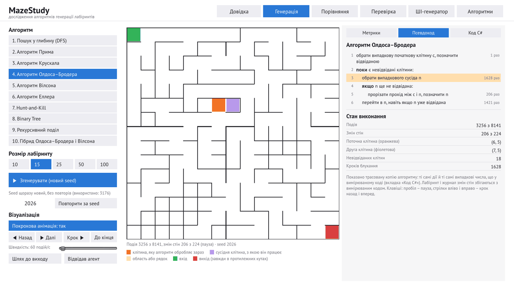
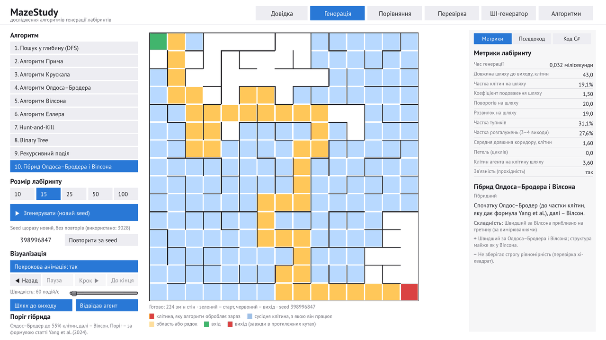
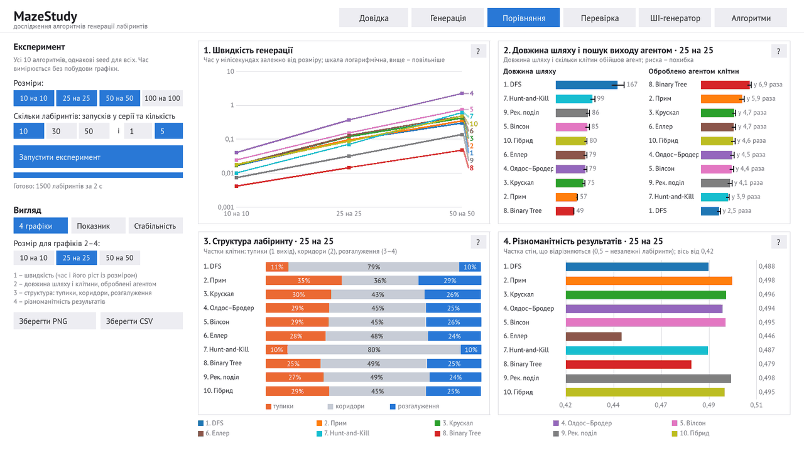
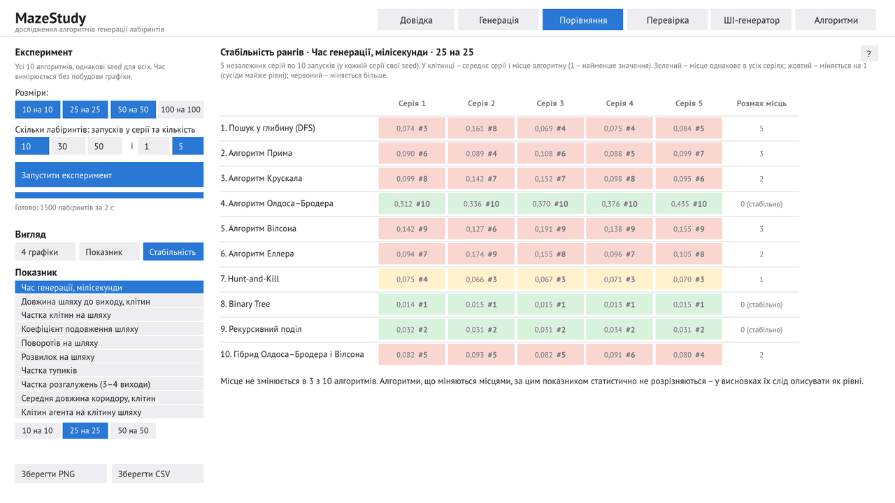
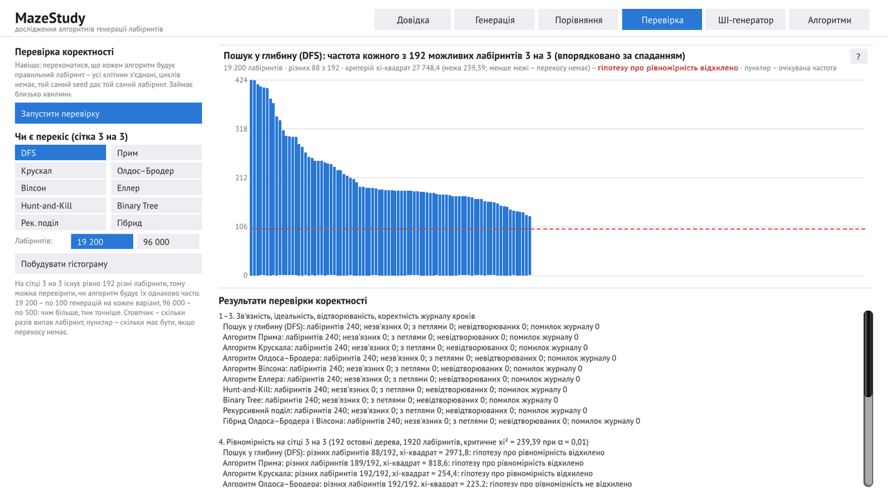
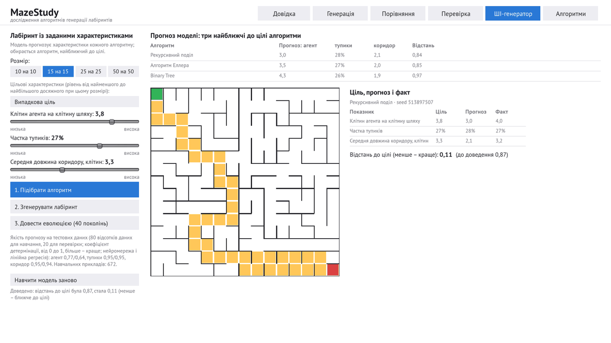
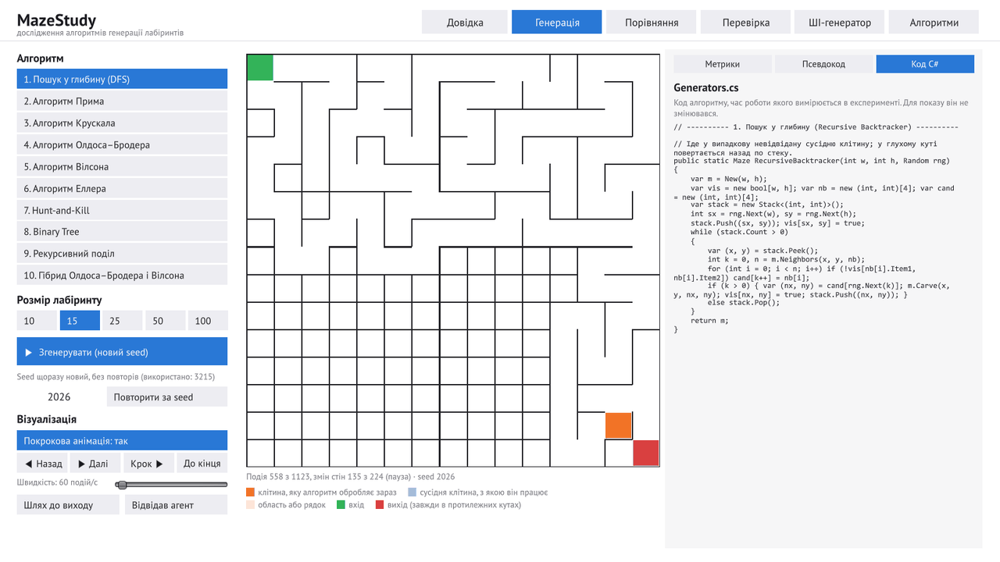

# Посібник користувача MazeStudy

Тут описано кожну вкладку програми: що на ній можна зробити і як читати те, що видно на екрані. У самій програмі є кнопки «?» біля кожного графіка і вкладка «Довідка», там те саме коротше.

## 1. Генерація

Ліворуч обираємо алгоритм і розмір лабіринту, потім натискаємо «Згенерувати». Кожен раз береться новий seed (число, від якого залежать випадкові вибори). Щоб отримати той самий лабіринт ще раз, введіть seed у поле і натисніть «Повторити за seed».

Якщо увімкнено «Покрокова анімація», лабіринт будується повільно, і видно кожну дію алгоритму:

| Колір | Що означає |
|---|---|
| оранжевий | клітина, з якою алгоритм працює зараз |
| фіолетовий | сусідня клітина, до якої він може прорізати прохід |
| світло-жовтий | область або рядок, які алгоритм обробляє (у Еллера, рекурсивного поділу) |
| зелений | вхід |
| червоний | вихід, завжди в протилежному куті |

Керування: пробіл ставить на паузу, стрілки вліво і вправо роблять крок назад або вперед. Кнопка «До кінця» одразу добудовує лабіринт.

Праворуч три вкладки:

- **Метрики** – показники готового лабіринту (див. таблицю нижче);
- **Псевдокод** – алгоритм простими словами; рядок, який виконується зараз, підсвічено, а праворуч видно, скільки разів виконався кожен рядок;
- **Код C#** – той самий алгоритм у коді програми.

Кнопка «Шлях до виходу» показує жовтим найкоротший шлях. Кнопка «Відвідав агент» показує блакитним клітини, які пройшов простий агент, поки шукав вихід. Агент іде пошуком у глибину і на розвилках обирає напрямок випадково. Чим більше блакитних клітин, тим довше агент блукав.

### Що означають показники

| Показник | Як рахується | Що каже про лабіринт |
|---|---|---|
| Час генерації | мілісекунди на побудову | чи підійде алгоритм для великих рівнів або генерації під час гри |
| Довжина шляху до виходу | кількість клітин у найкоротшому шляху від входу до виходу | скільки треба пройти |
| Частка клітин на шляху | довжина шляху, поділена на всі клітини | яка частина лабіринту лежить на правильному шляху |
| Коефіцієнт подовження шляху | у скільки разів шлях довший за найкоротший можливий, якби стін не було (лише вправо і вниз) | 1 – шлях прямий, більше – шлях петляє |
| Повороти, розвилки на шляху | рахуються вздовж найкоротшого шляху | скільки разів треба повертати і де можна помилитися |
| Частка тупиків | клітини з одним виходом | чим більше, тим більше коротких відгалужень |
| Частка розгалужень | клітини з трьома або чотирма виходами | скільки місць, де треба обирати |
| Середня довжина коридору | клітини з двома виходами, що йдуть підряд | довгі коридори чи дрібні кімнатки |
| Клітин агента на клітину шляху | скільки клітин обробив агент, поділене на довжину шляху | наскільки важко знайти вихід перебором |
| Петель | кількість циклів | в ідеальному лабіринті завжди 0 |

## 2. Порівняння

Тут усі десять алгоритмів будують лабіринти з однаковими seed. Оберіть розміри, кількість запусків у серії і кількість серій, потім натисніть «Запустити експеримент». Час вимірюється окремо від малювання, щоб інтерфейс не впливав на результат.

Чотири графіки:

1. **Швидкість** – час залежно від розміру. Шкала логарифмічна: кожна поділка в 10 разів більша за попередню.
2. **Довжина шляху і пошук агентом** – ліворуч довжина шляху, праворуч у скільки разів більше клітин обійшов агент, ніж довжина шляху. Риска на кінці стовпчика – похибка (95 % довірчий інтервал).
3. **Структура** – яка частина клітин тупики, коридори і розгалуження.
4. **Різноманітність** – наскільки лабіринти одного алгоритму відрізняються між собою. 0,5 означає, що лабіринти зовсім незалежні.

Вигляд «Показник» показує один показник для всіх розмірів. Вигляд «Стабільність» показує, чи зберігають алгоритми свої місця, якщо експеримент повторити кілька разів:

Зелена клітинка означає, що місце алгоритму однакове в усіх серіях. Жовта означає, що воно змінюється на одне. Червона означає більші зміни. Якщо алгоритми міняються місцями, за цим показником їх не можна вважати різними, і в висновках вони описані як рівні.

«Зберегти PNG» і «Зберегти CSV» записують графіки і всі виміри в папку `MazeStudy_results` на робочому столі.

## 3. Перевірка

Кнопка «Запустити перевірку» будує по 240 лабіринтів кожним алгоритмом і перевіряє, що:

- усі клітини з'єднані;
- немає жодної петлі;
- той самий seed дає той самий лабіринт;
- покрокова копія алгоритму робить те саме, що й вимірюваний код.

Нижня частина – перевірка на перекіс. На сітці 3 на 3 існує рівно 192 різні ідеальні лабіринти. Якщо алгоритм не має перекосу, кожен з них має випадати приблизно однаково часто (пунктирна лінія). На знімку видно пошук у глибину: він будує лише 88 з 192 лабіринтів, і одні випадають набагато частіше за інші. Без перекосу працюють тільки алгоритми Олдоса–Бродера і Вілсона, це збігається з теорією. Рішення ухвалюється критерієм хі-квадрат: якщо значення більше за межу 239,39, перекіс є.

## 4. ШІ-генератор

Тут можна задати, який лабіринт потрібен, і програма спробує його зробити:

1. Оберіть розмір і пересуньте повзунки: наскільки важко шукати вихід, скільки тупиків, які довгі коридори. Або натисніть «Випадкова ціль».
2. «Підібрати алгоритм» – модель прогнозує показники кожного алгоритму, і вгорі з'являються три найближчі до цілі.
3. «Згенерувати лабіринт» – будує лабіринт найкращим алгоритмом.
4. «Довести еволюцією» – 40 поколінь маленьких змін: відкриваємо одну стіну і закриваємо іншу на утвореній петлі, тому лабіринт лишається правильним. Зміна залишається, якщо лабіринт став ближчим до цілі.

Праворуч таблиця «Ціль, прогноз і факт» і відстань до цілі: менше означає краще. На знімку відстань зменшилася з 0,87 до 0,11.

Чесний результат експерименту: користь дають вибір алгоритму і доведення. Нейромережа прогнозує не краще, ніж проста таблиця середніх значень (подробиці в розділі 3 роботи).

## 5. Код C#

Тут видно справжній код алгоритму з файлу `Core/Generators.cs`, саме той, час якого вимірюється. Рядок, який відповідає поточному кроку анімації, підсвічено.
